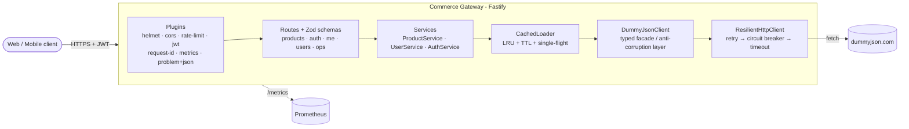

# Commerce Gateway API

A production-style **Backend-for-Frontend / API gateway** written in TypeScript on Fastify 5.
It sits in front of the public mock API [DummyJSON](https://dummyjson.com) (products, carts,
users, auth) and gives clients one clean REST API that stays stable when the upstream is slow
or failing.

The upstream is a stand-in. The project is about what goes around it: resilience, caching,
auth, validation and observability, written so each part can be unit-tested.

## Highlights

- **Resilient upstream client**: per-attempt timeouts, retries with exponential backoff and full
  jitter, and a hand-written circuit breaker (closed / open / half-open).
- **Read-through cache with request coalescing**: an in-memory LRU with TTL plus single-flight, so
  N concurrent identical requests produce exactly one upstream call (`x-cache: HIT | MISS | COALESCED`).
- **Gateway-owned auth**: credentials are verified against DummyJSON, and the gateway then issues
  its own short-lived HS256 JWT.
- **Aggregation with partial-failure tolerance**: `GET /users/:id/summary` fans out to users,
  carts and product details in parallel, with bounded concurrency.
- **Contracts everywhere**: Zod validates env vars, requests, responses and upstream payloads,
  and the OpenAPI 3.1 spec is generated from the same schemas (`/docs`).
- **RFC 7807 errors**: every error is returned as `application/problem+json` with a stable `type`.
- **Operations**: `/health` (liveness), `/ready` (readiness, including circuit state), Prometheus
  `/metrics`, request IDs, structured pino logs with secrets redacted, graceful shutdown, rate
  limiting, helmet and CORS.

## Architecture



A request goes through these layers:

1. **Plugins** assign a request ID, apply rate limiting and security headers, and verify the JWT on
   protected routes.
2. **Routes** validate params, query and body with Zod, and serialise the response through a Zod
   schema, so internal fields cannot leak by accident.
3. **Services** hold the business logic: mapping, aggregation and computed fields such as
   `finalPrice`.
4. **CachedLoader** answers from the cache, joins an in-flight request, or loads from upstream.
5. **DummyJsonClient** turns upstream quirks into domain errors (`404 → NotFoundError`,
   `400 on login → UnauthorizedError`).
6. **ResilientHttpClient** handles timeouts, retries and the circuit breaker, then checks the
   2xx payload against a Zod contract.

All wiring happens in one composition root (`src/container.ts`). Collaborators are injected
through constructors, and the container is exposed to routes as `app.deps`. In tests, an
in-process fake replaces `fetch`, so the full resilience pipeline runs without touching the
network.

## Design decisions

| Concern                   | Decision                                                                                                                        | Why                                                                                                                                                                                                                                                   |
| ------------------------- | ------------------------------------------------------------------------------------------------------------------------------- | ----------------------------------------------------------------------------------------------------------------------------------------------------------------------------------------------------------------------------------------------------- |
| **Timeouts**              | `AbortSignal.timeout()` on every attempt                                                                                        | A hung upstream would otherwise hold sockets and memory until the client gives up. Timeouts map to `504`.                                                                                                                                             |
| **Retries**               | Exponential backoff with **full jitter**, only for **idempotent** methods and **transient** errors (5xx, 429, network, timeout) | Retrying a 404 is pointless, and retrying a `POST /auth/login` is unsafe. Jitter spreads out retries so many clients don't hit a recovering upstream at the same moment.                                                                              |
| **Circuit breaker**       | Hand-written three-state breaker. 4xx responses count as successes.                                                             | When DummyJSON is down, the gateway fails fast with `503` and `Retry-After` instead of waiting on timeouts. This keeps gateway latency bounded and gives the upstream room to recover. A single half-open probe decides whether to close the breaker. |
| **Retry ↔ breaker order** | `retry( breaker( attempt ) )`                                                                                                   | Every attempt is checked against the breaker, and an open circuit (`CircuitOpenError`) is never retried.                                                                                                                                              |
| **Caching**               | Async `Cache` interface with an in-memory LRU + TTL implementation                                                              | Reads are O(1) using `Map` insertion order. The interface is async, so a Redis adapter could replace the LRU without changing any service code.                                                                                                       |
| **Single-flight**         | Concurrent misses for the same key share one promise                                                                            | Prevents cache stampedes. When a hot key expires, 100 concurrent requests still produce one upstream call. Errors are never cached.                                                                                                                   |
| **Aggregation**           | `Promise.allSettled` plus a bounded worker pool (5) for product enrichment                                                      | The user record is mandatory, so its failure fails the request. Carts and product details degrade gracefully: the response includes `partial: true` and an `errors[]` list instead of a `500`.                                                        |
| **Auth**                  | Upstream tokens are discarded and the gateway issues its own JWT (`iss=commerce-gateway`, HS256 pinned)                         | Clients are decoupled from the identity provider, the token lifetime is under our control, and we never pass through tokens we didn't mint.                                                                                                           |
| **Anti-corruption layer** | Upstream payloads are parsed with Zod, which strips unknown keys                                                                | DummyJSON returns plaintext `password` fields on users. Stripping unknown keys means they cannot reach a client. Contract drift results in a `502` instead of a confusing response.                                                                   |
| **Errors**                | Typed `AppError` hierarchy → RFC 7807                                                                                           | Clients get a stable `type` URI to branch on. Details of 5xx errors are logged, not returned.                                                                                                                                                         |
| **Metrics**               | A small hand-written Prometheus registry                                                                                        | Covers the RED metrics, upstream outcomes, retries, cache results and breaker state without adding a dependency. Labels use route templates to keep cardinality bounded.                                                                              |
| **Shutdown**              | On `SIGTERM`/`SIGINT`: `/ready` starts returning 503, in-flight requests drain via `app.close()`, and a hard timeout applies    | Allows zero-downtime rolling deploys behind a load balancer or Kubernetes.                                                                                                                                                                            |

## Endpoints

| Method | Path                   | Auth   | Description                                                                                |
| ------ | ---------------------- | ------ | ------------------------------------------------------------------------------------------ |
| GET    | `/products`            | –      | List products. Query: `page`, `limit` (1–100), `q`, `category`, `sortBy`, `order`. Cached. |
| GET    | `/products/categories` | –      | Category list (cached for 10 min).                                                         |
| GET    | `/products/:id`        | –      | Single product with computed `finalPrice` / `inStock`. Cached.                             |
| POST   | `/auth/login`          | –      | `{ username, password }` → gateway JWT. Stricter rate limit (10/min).                      |
| GET    | `/me`                  | Bearer | Current user profile.                                                                      |
| GET    | `/me/carts`            | Bearer | Current user's carts.                                                                      |
| GET    | `/me/summary`          | Bearer | Aggregated summary for the current user.                                                   |
| GET    | `/users/:id/summary`   | –      | Aggregated profile + carts + enriched products, partial-failure tolerant.\*                |
| GET    | `/health`              | –      | Liveness. Never depends on the upstream.                                                   |
| GET    | `/ready`               | –      | Readiness. Returns `503` while shutting down or while the upstream circuit is open.        |
| GET    | `/metrics`             | –      | Prometheus text format.                                                                    |
| GET    | `/docs`                | –      | Swagger UI. The OpenAPI JSON is at `/docs/json`.                                           |

\* This endpoint is public so the demo is easy to try. In a real deployment it would require an
authorization check.

Example error:

```json
{
  "type": "https://commerce-gateway.dev/problems/circuit-open",
  "title": "Service temporarily unavailable",
  "status": 503,
  "detail": "Upstream circuit breaker is open; failing fast",
  "instance": "/products/2",
  "requestId": "6f1c0a52-3c1e-4b8e-9a43-0d6c5a1f2b7e"
}
```

## Quick start

Requires Node.js 22.12 or later.

```bash
cp .env.example .env          # set JWT_SECRET to a long random value
npm install
npm run dev                   # http://localhost:3000, docs at http://localhost:3000/docs
```

Try it:

```bash
curl -i 'http://localhost:3000/products?limit=2'          # x-cache: MISS, then HIT
TOKEN=$(curl -s -X POST http://localhost:3000/auth/login \
  -H 'content-type: application/json' \
  -d '{"username":"emilys","password":"emilyspass"}' | jq -r .accessToken)
curl -H "authorization: Bearer $TOKEN" http://localhost:3000/me
curl http://localhost:3000/users/33/summary
```

With Docker:

```bash
docker compose up --build
```

The image is a multi-stage build. It ships only production dependencies, runs as the non-root
`node` user, and includes a `HEALTHCHECK`. Its exec-form `CMD` lets `SIGTERM` reach Node, so
graceful shutdown works in containers.

## Configuration

All variables are validated at startup. Invalid configuration fails fast with a readable message.

| Variable                       | Default                 | Description                                                    |
| ------------------------------ | ----------------------- | -------------------------------------------------------------- |
| `NODE_ENV`                     | `development`           | `development` enables pretty logs.                             |
| `HOST` / `PORT`                | `0.0.0.0` / `3000`      | Listen address.                                                |
| `LOG_LEVEL`                    | `info`                  | pino level.                                                    |
| `UPSTREAM_BASE_URL`            | `https://dummyjson.com` | Upstream API.                                                  |
| `UPSTREAM_TIMEOUT_MS`          | `3000`                  | Per-attempt timeout.                                           |
| `UPSTREAM_MAX_RETRIES`         | `2`                     | Retries after the first attempt (idempotent requests).         |
| `UPSTREAM_RETRY_BASE_DELAY_MS` | `100`                   | Backoff base. The delay is `rand(0, base·2^n)`, capped at 2 s. |
| `CB_FAILURE_THRESHOLD`         | `5`                     | Consecutive failures before the circuit opens.                 |
| `CB_RESET_TIMEOUT_MS`          | `10000`                 | Open → half-open cool-down.                                    |
| `CACHE_MAX_ENTRIES`            | `1000`                  | LRU capacity.                                                  |
| `CACHE_TTL_MS`                 | `30000`                 | Default TTL (carts 5 s, categories 10 min).                    |
| `JWT_SECRET`                   | **required**            | At least 32 characters.                                        |
| `JWT_TTL_SECONDS`              | `900`                   | Gateway token lifetime.                                        |
| `RATE_LIMIT_MAX`               | `100`                   | Requests per window per IP. Probes are exempt.                 |
| `RATE_LIMIT_WINDOW_MS`         | `60000`                 | Rate-limit window.                                             |
| `CORS_ORIGIN`                  | `*`                     | Comma-separated list of allowed origins.                       |
| `TRUST_PROXY`                  | `false`                 | Trust `X-Forwarded-*`. Enable only behind a proxy.             |
| `SHUTDOWN_TIMEOUT_MS`          | `10000`                 | Hard limit for graceful shutdown.                              |

## Testing

```bash
npm test              # all tests
npm run test:coverage # with V8 coverage
```

- **Unit tests** cover the circuit breaker (all transitions, using an injected clock), retry and
  backoff math, LRU eviction and TTL, single-flight coalescing and error propagation, the bounded
  concurrency helper, and the resilient HTTP client (retries, timeouts, idempotency, breaker, and
  contract violations).
- **Integration tests** call the real Fastify app through `app.inject()`, with an in-process fake
  DummyJSON injected as `fetch`. They cover pagination, caching and coalescing headers, validation
  problems, the JWT flow, partial aggregation, 502/503/504 mapping, readiness flipping, metrics,
  request IDs, rate limiting and the OpenAPI document. **No test touches the network.**

The other quality gates are `npm run lint` (ESLint flat config, `strictTypeChecked`),
`npm run typecheck` and `npm run format:check`. CI runs all of them on Node 22 and 24, then
builds the Docker image.

## Project structure

```
src/
├── app.ts                    # Fastify factory: plugins, routes, DI wiring
├── server.ts                 # entrypoint: listen + graceful shutdown
├── container.ts              # composition root (dependency injection)
├── config/env.ts             # Zod-validated configuration
├── http/
│   ├── upstream-client.ts    # timeout → circuit breaker → retry pipeline
│   ├── dummyjson-client.ts   # typed upstream facade
│   └── dummyjson.schemas.ts  # upstream contracts (anti-corruption layer)
├── lib/
│   ├── circuit-breaker.ts
│   ├── retry.ts
│   ├── concurrency.ts
│   ├── errors.ts             # AppError hierarchy, RFC 7807 types
│   ├── metrics.ts            # Prometheus registry
│   └── cache/                # Cache interface, LRU, single-flight, CachedLoader
├── plugins/                  # auth (JWT), error handler, metrics, swagger
└── modules/
    ├── products/             # routes · service · schemas
    ├── auth/
    ├── users/                # /me, /users/:id/summary
    └── health/
test/
├── unit/
├── integration/
└── helpers/                  # fake upstream, fixtures, app builder
```

## License

[MIT](LICENSE) © 2026 Yusuf Yuldashev
